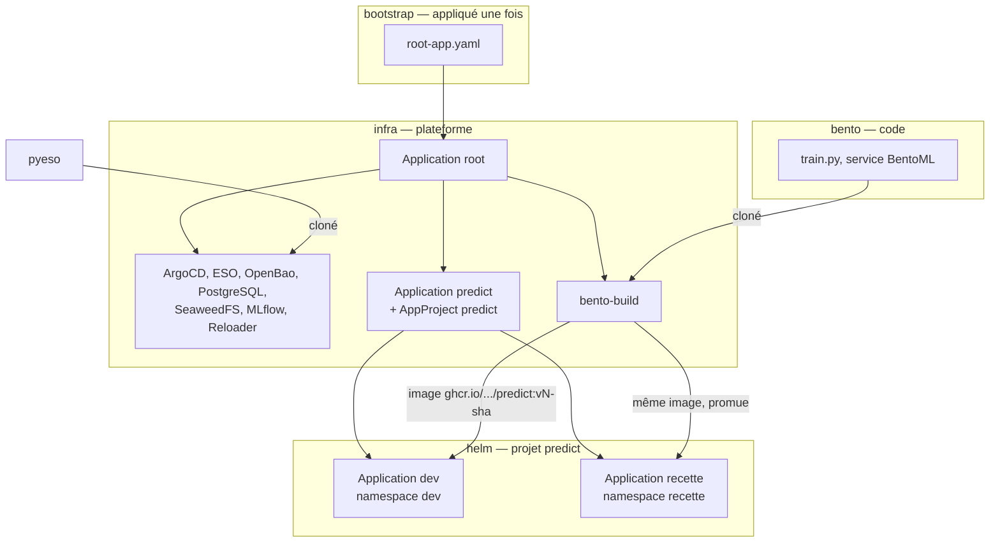

# ArgoCD_Udemy

POC GitOps complet sur un cluster Kubernetes local (MicroK8s sous WSL2), piloté par **ArgoCD** : une **plateforme** (secrets, base de données, stockage, suivi de modèles ML) et un **projet applicatif** déployé en **dev** et en **recette** à partir d'un chart Helm umbrella.

Cette branche ne contient que ce README : **chaque branche a un rôle**, et son propre README détaille son contenu.

## Les branches

| Branche | Rôle | Lue par | README |
|---|---|---|---|
| **`main`** | Présentation du repo | — | ce fichier |
| **`bootstrap`** | Installation : MicroK8s, ArgoCD, Application racine `root` | appliquée **une fois** à la main | [bootstrap](../../tree/bootstrap) |
| **`infra`** | Plateforme : toutes les Applications ArgoCD, AppProjects, values Helm, manifests | ArgoCD (`root`) | [infra](../../tree/infra) |
| **`pyeso`** | Outils Python de gestion des secrets (rotation des clés S3 de MLflow) | CronJob de rotation | [pyeso](../../tree/pyeso) |
| **`bento`** | Code de l'API **predict** : entraînement, service BentoML, préparation de l'image | job de build `bento-build` | [bento](../../tree/bento) |
| **`helm`** | Chart umbrella **predict** + values `dev` / `recette` + Applications `dev` / `recette` | ArgoCD (Application `predict`) | [helm](../../tree/helm) |

`bootstrap`, `infra` et `main` partagent un historique ; `pyeso`, `bento` et `helm` sont des branches **orphelines** (code ou chart sans lien avec l'historique de la plateforme).

## Vue d'ensemble

## Cycle de vie d'une version de l'API predict

1. **Entraîner** un modèle (`bento:train.py`) : il est enregistré dans le registre **MLflow** avec l'alias `@dev`.
2. **Construire l'image** : le job `bento-build` (`infra`) package la version `@dev` avec **BentoML** et la pousse sur **GHCR** (`v<version du modèle>-<commit>`). Le modèle est dans l'image.
3. **Déployer en dev** : le tag est reporté dans `helm:predict/values-dev.yaml`. ArgoCD déploie, puis un smoketest vérifie l'API.
4. **Promouvoir en recette** : le **même tag** est reporté dans `helm:predict/values-recette.yaml`. La recette exécute exactement l'image testée en dev.

Dev et recette servent donc des modèles différents tant qu'une version n'a pas été promue.

## Répartition des responsabilités

| Qui | Branche | Contrôle |
|---|---|---|
| Plateforme | `infra` | Composants partagés, **droits des projets** (AppProjects), bases de données, point d'entrée de chaque projet |
| Projet predict | `helm`, `bento` | Code, chart, values par environnement, version déployée dans chaque environnement |

Un projet déploie en autonomie sur `helm`, mais ne peut pas élargir ses droits : ses namespaces autorisés sont définis dans l'AppProject `predict`, sur `infra`.

## Démarrer

1. Branche `bootstrap` : installer MicroK8s et ArgoCD, puis appliquer `root-app.yaml`.
2. Branche `infra`, section « Prérequis manuels » : initialiser OpenBao et créer les secrets hors Git.
3. Branches `bento` puis `helm` : entraîner un premier modèle, construire l'image, renseigner les tags.
