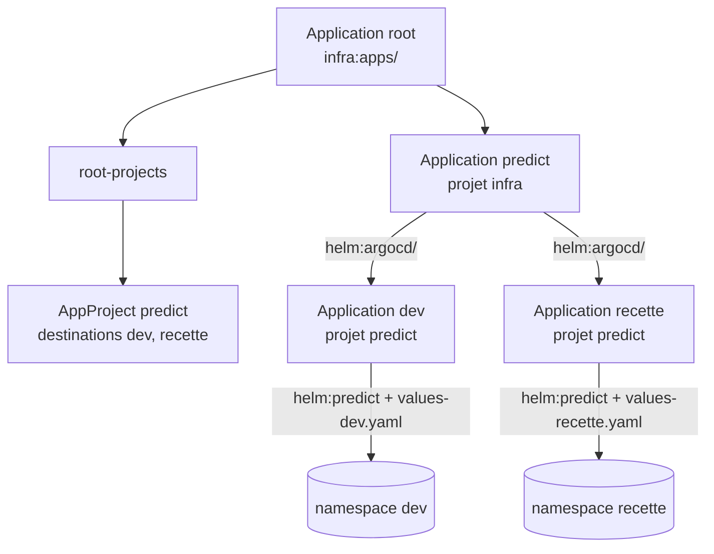

# ArgoCD_Udemy — branche `helm`

Déploiement de l'application **predict** (API de prédiction BentoML, code sur la branche `bento`) dans deux environnements, **dev** et **recette**, à partir d'un même **chart umbrella**. Branche **orpheline**.

| Branche | Contenu | Qui la lit |
|---|---|---|
| `infra` | Plateforme ; AppProject `predict`, Application d'entrée `predict`, bases PostgreSQL, job de build | ArgoCD (`root`) |
| `bento` | Code de l'API, entraînement, préparation de l'image | Job de build `bento-build` |
| **`helm`** | Applications `dev` / `recette` + chart umbrella `predict` | **ArgoCD** (Application `predict`) |

## Contenu

```
argocd/                       # synchronisé par l'Application "predict" (branche infra)
├── dev.yaml                  # Application "dev"     -> namespace dev,     values-dev.yaml
└── recette.yaml              # Application "recette" -> namespace recette, values-recette.yaml
predict/                      # chart umbrella
├── Chart.yaml                # dépendances : api, smoketest (sous-charts locaux)
├── values.yaml               # valeurs communes
├── values-dev.yaml           # surcharges dev
├── values-recette.yaml       # surcharges recette
└── charts/
    ├── api/                  # Deployment + Service + ExternalSecret (identifiants PostgreSQL)
    └── smoketest/            # Job PostSync : appelle l'API après chaque sync
```

## Chaîne ArgoCD



- Le **point d'entrée** (Application `predict`) et les **droits** (AppProject `predict`) sont sur `infra`. Tout le reste est ici : l'équipe du projet déploie sans toucher à la plateforme.
- L'AppProject `predict` n'autorise que ce repo, les namespaces `dev` et `recette`, et le kind `Namespace` (créé par `CreateNamespace=true`). Ajouter un environnement demande donc une modification sur `infra` (nouvelle destination, nouvelle base).
- Chaque Application porte le nom de son namespace ; la release Helm aussi.

## Le chart umbrella

| Composant | Ressources | Rôle |
|---|---|---|
| `api` | `Deployment` `predict`, `Service` `predict` (NodePort), `ExternalSecret` `predict-db` | Le service BentoML ; identifiants PostgreSQL du static role OpenBao de l'environnement |
| `smoketest` (`smoketest.enabled`) | `Job` `smoketest` (hook `PostSync`) | Vérifie `/info` (bon environnement) et `/predict` ; s'il échoue, le sync ArgoCD est en échec |

`global.environment` est partagé par les deux sous-charts (variable `ENVIRONMENT` de l'API, contrôle du smoketest).

| | dev | recette |
|---|---|---|
| Namespace / Application | `dev` | `recette` |
| Réplicas | 1 | 2 |
| NodePort | **30801** | **30802** |
| Base PostgreSQL | `predict_dev` | `predict_recette` |
| Static role OpenBao | `predict-dev-role` | `predict-recette-role` |
| Image | dernier build (`@dev` MLflow) | tag promu depuis dev |

Choix notables :
- **`api.image.tag` est obligatoire** : sans tag, le rendu échoue avec un message explicite (visible dans ArgoCD) plutôt que de déployer une image inexistante.
- **Reloader** : le Deployment porte `secret.reloader.stakater.com/reload: predict-db`. Quand OpenBao change le mot de passe (toutes les 24 h) et qu'ESO met le Secret à jour, l'API redémarre.
- `maxUnavailable: 0` : l'ancien pod sert jusqu'à ce que le nouveau soit prêt (sonde `/readyz`).
- `runAsUser: 1034` : l'image déclare `USER bentoml` (non numérique), que kubelet ne peut pas vérifier avec `runAsNonRoot`.
- L'API démarre même si la base est indisponible : la journalisation est faite au mieux.

```bash
# Rendu local
helm template dev predict -n dev -f predict/values-dev.yaml --set api.image.tag=v2-1a2b3c4
```

## Déployer une nouvelle version

1. Entraîner un modèle et construire l'image (voir le README de la branche `bento`). Le job affiche le tag poussé, ex. `v3-1a2b3c4`.
2. **dev** : mettre ce tag dans `predict/values-dev.yaml` (`api.image.tag`), commit, push. ArgoCD déploie, puis le smoketest vérifie l'API.
3. **recette** : une fois la version validée en dev, reporter **le même tag** dans `predict/values-recette.yaml`.

```bash
curl -s -X POST http://<IP>:30801/info -H 'content-type: application/json' -d '{}'   # dev
curl -s -X POST http://<IP>:30802/info -H 'content-type: application/json' -d '{}'   # recette
```

Retour arrière : `git revert` du commit qui a changé le tag.

## Prérequis (branche `infra`)

Faits une fois, voir le README de `infra` (« Projet predict ») :
- bases `predict_dev` / `predict_recette` (Jobs de l'Application `postgres`) et static roles `predict-dev-role` / `predict-recette-role` dans OpenBao ;
- PAT GitHub dans OpenBao (`secret/ghcr`) pour le job de build ;
- package GHCR `predict` rendu **public** après le premier push (sinon ajouter un `imagePullSecrets`).
