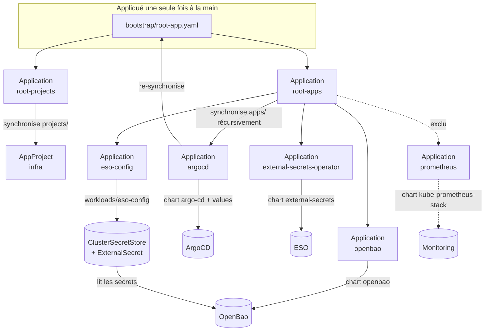

# ArgoCD_Udemy

Lab GitOps d'un cluster Kubernetes local (MicroK8s sous WSL2), entièrement piloté par **ArgoCD** selon le pattern **app-of-apps**.

Une fois le bootstrap effectué, **Git est la seule source de vérité** : toute modification du cluster passe par un commit sur `main`, qu'ArgoCD applique automatiquement.

Composants déployés :

| Composant | Rôle | Namespace |
|---|---|---|
| **ArgoCD** | Moteur GitOps, se gère lui-même depuis ce repo | `argocd` |
| **External Secrets Operator (ESO)** | Synchronise des secrets externes vers des `Secret` Kubernetes | `external-secrets` |
| **OpenBao** | Coffre-fort de secrets (fork open source de Vault), en mode dev | `openbao` |
| **kube-prometheus-stack** | Prometheus, Grafana, Alertmanager — **déploiement manuel** (voir plus bas) | `monitoring` |

---

## Sommaire

- [Architecture](#architecture)
- [Structure du repo](#structure-du-repo)
- [Description détaillée des fichiers](#description-détaillée-des-fichiers)
- [Installation depuis zéro](#installation-depuis-zéro)
- [Prérequis manuels (secrets)](#prérequis-manuels-secrets)
- [Accès aux interfaces](#accès-aux-interfaces)
- [Ordre de déploiement (sync waves)](#ordre-de-déploiement-sync-waves)
- [Opérations courantes](#opérations-courantes)
- [Choix techniques et pièges connus](#choix-techniques-et-pièges-connus)
- [Sécurité](#sécurité)
- [Sources](#sources)

---

## Architecture



Points clés :

- **`root-app.yaml` est le seul fichier appliqué à la main.** Il crée deux Applications « racines » :
  - `root-projects` → synchronise le dossier `projects/` (les **AppProjects**) ;
  - `root-apps` → synchronise le dossier `apps/` (toutes les **Applications**).
- **ArgoCD se gère lui-même** : l'Application `argocd` déploie le chart Helm d'ArgoCD *et* re-synchronise `bootstrap/root-app.yaml`. Le bootstrap lui-même est donc versionné et appliqué depuis Git.
- Chaque composant est une **Application séparée** (une « tuile » dans l'UI ArgoCD), ce qui permet de les synchroniser, diagnostiquer ou supprimer indépendamment.

---

## Structure du repo

```
ArgoCD_Udemy/
├── README.md                          # ce fichier
├── bootstrap/                         # tout ce qui sert à démarrer le cluster
│   ├── install_kub_microk8s.sh        # 1. installe MicroK8s sous WSL2
│   ├── install_ArgoCD.sh              # 2. installe ArgoCD (Helm) + CLI + applique root-app.yaml
│   ├── argocd-values.yaml             # values Helm d'ArgoCD (utilisées par le script ET par l'app argocd)
│   └── root-app.yaml                  # 3. point d'entrée GitOps : root-projects + root-apps
├── projects/                          # AppProjects — synchronisé par root-projects
│   └── infra-project.yaml             # AppProject "infra" (droits des apps plateforme)
├── apps/                              # Applications ArgoCD — synchronisé par root-apps (récursif)
│   └── platform/                      # composants d'infrastructure
│       ├── argocd/
│       │   └── application.yaml       # ArgoCD qui se gère lui-même
│       ├── external-secret-operator/
│       │   ├── operator/
│       │   │   └── application.yaml   # l'opérateur ESO (chart Helm)
│       │   └── config/
│       │       └── application.yaml   # pointe vers workloads/eso-config
│       ├── openbao/
│       │   └── application.yaml       # OpenBao (chart Helm, mode dev)
│       └── prometheus/
│           └── application.yaml       # kube-prometheus-stack — EXCLU de root-apps
├── workloads/                         # manifests "bruts" référencés par des Applications
│   └── eso-config/
│       └── eso.yaml                   # ClusterSecretStore OpenBao + ExternalSecret de démo
└── roar-k8s-helm.yaml                 # exercice du cours, NON géré par le GitOps
```

### Logique de découpage

| Dossier | Contient | Synchronisé par | Règle |
|---|---|---|---|
| `bootstrap/` | Scripts d'installation + point d'entrée | appliqué à la main, puis par l'app `argocd` | Ne contient que ce qui est nécessaire *avant* qu'ArgoCD tourne |
| `projects/` | Uniquement des `AppProject` | `root-projects` | Un fichier par projet |
| `apps/` | Uniquement des `Application` ArgoCD | `root-apps` (récursif) | Un dossier par composant, un fichier `application.yaml` |
| `workloads/` | Manifests Kubernetes classiques | une Application de `apps/` qui pointe dessus | Jamais synchronisé directement par une app racine |

> ⚠️ Un objet Kubernetes ne doit être défini **qu'à un seul endroit**. Si deux Applications gèrent le même objet, elles le réécrivent chacune leur tour et passent en OutOfSync en boucle (c'est arrivé avec l'AppProject `infra`, voir [Pièges connus](#choix-techniques-et-pièges-connus)).

---

## Description détaillée des fichiers

### `bootstrap/install_kub_microk8s.sh`

Installe un cluster Kubernetes mono-nœud **MicroK8s** dans WSL2.

- ⚠️ **Désactiver l'intégration Docker Desktop dans WSL2 avant de lancer le script.**
- Installe MicroK8s via `snap`, attend qu'il soit prêt.
- Active les addons `dns`, `storage` (StorageClass hostpath pour les PVC) et `dashboard`.
- Crée les alias `kubectl` → `microk8s kubectl` et `helm` → `microk8s helm` dans `~/.bashrc`.
- Lance un pod `hello-world` de test puis le supprime.

### `bootstrap/install_ArgoCD.sh`

Installe ArgoCD puis amorce le GitOps. **À lancer depuis la racine du repo** (les chemins `bootstrap/...` sont relatifs).

1. Ajoute le repo Helm `argo` et installe le chart `argo-cd` **10.1.3** (release `argocd`, namespace `argocd`) avec `bootstrap/argocd-values.yaml`.
2. Désactive temporairement les `ServiceMonitor` (`--set ...serviceMonitor.enabled=false`) : leur CRD n'existe pas tant que Prometheus n'est pas installé, et le `helm install` échouerait.
3. Attend que `argocd-server` soit prêt.
4. Installe la CLI `argocd` **v3.4.5** dans `/usr/local/bin`.
5. Affiche le mot de passe admin initial (secret `argocd-initial-admin-secret`) et l'IP du nœud.
6. Se connecte à ArgoCD via la CLI (`<IP>:30080`, `--insecure --grpc-web`).
7. Applique `bootstrap/root-app.yaml` → à partir de là, tout le reste est déployé par ArgoCD.
8. Affiche `argocd app list` et la version.

> Le nom de release `argocd` et la version `10.1.3` doivent rester **identiques** dans `apps/platform/argocd/application.yaml`, sinon ArgoCD installerait une seconde copie de lui-même au lieu de reprendre la release existante.

### `bootstrap/argocd-values.yaml`

Values Helm d'ArgoCD. Utilisées **à deux endroits** : par `install_ArgoCD.sh` au premier install, puis par l'Application `argocd` (via la référence `$values`). Modifier ce fichier et pousser suffit donc à reconfigurer ArgoCD.

| Paramètre | Valeur | Effet |
|---|---|---|
| `server.service.type` / `nodePorts.http` | `NodePort` / `30080` | UI et API ArgoCD accessibles sur `http://<IP-noeud>:30080` |
| `server.insecure` (`configs.params`) | `true` | ArgoCD sert en HTTP (pas de TLS) — acceptable pour un lab local |
| `*.metrics.enabled` | `true` | Expose les métriques de `server`, `controller` et `repoServer` |
| `*.metrics.serviceMonitor.enabled` | `true` | Crée des `ServiceMonitor` pour que Prometheus scrape ArgoCD |
| `serviceMonitor.additionalLabels.release` | `prometheus` | Label attendu par le sélecteur de kube-prometheus-stack (release `prometheus`) |

### `bootstrap/root-app.yaml`

**Point d'entrée GitOps.** Appliqué à la main une seule fois (`kubectl apply -f bootstrap/root-app.yaml`), puis maintenu par l'Application `argocd`.

Contient deux Applications :

**`root-projects`** (sync-wave `-1`)
- Synchronise `projects/` (récursif) dans le namespace `argocd`.
- Appartient au projet **`default`** : elle ne peut pas appartenir à `infra` puisque c'est elle qui crée `infra` (problème de l'œuf et de la poule sur un cluster neuf).
- `automated` avec `prune` + `selfHeal`, `ServerSideApply`.
- Annotation `Delete=false` : protège l'Application contre une suppression en cascade.

**`root-apps`**
- Synchronise `apps/` (récursif) dans le namespace `argocd`, projet `infra`.
- **Exclut `platform/prometheus/*`** : Prometheus n'est pas déployé automatiquement.
- `automated` avec `prune` + `selfHeal`, `ServerSideApply`.
- Annotation `Delete=false` + finalizer.

> ⚠️ `root-apps` a `prune: true` : **supprimer ou exclure un fichier de `apps/` supprime l'Application correspondante**, et grâce à son finalizer, **toutes les ressources qu'elle a déployées**. C'est voulu, mais à garder en tête.

### `projects/infra-project.yaml`

AppProject **`infra`**, utilisé par toutes les Applications plateforme. Il définit ce qu'elles ont le droit de faire :

- **`sourceRepos`** — d'où elles peuvent tirer leurs manifests :
  - ce repo Git ;
  - `https://argoproj.github.io/argo-helm` (chart ArgoCD) ;
  - `https://charts.external-secrets.io` (chart ESO) ;
  - `https://openbao.github.io/openbao-helm` (chart OpenBao) ;
  - `ghcr.io/prometheus-community/charts` (chart OCI kube-prometheus-stack).
- **`destinations`** — où elles peuvent déployer : `argocd`, `external-secrets`, `openbao`, `monitoring`, `production`, `kube-system` (certains charts y posent des composants, ex. Services de kubelet pour Prometheus).
- **`clusterResourceWhitelist: */*`** — autorise les ressources cluster-scoped (CRDs, ClusterRoles, webhooks…), nécessaires aux opérateurs.
- Annotation `Delete=false` : l'AppProject n'est jamais supprimé en cascade, même si `root-projects` l'est.

> Pour un **nouveau composant** utilisant un nouveau repo Helm ou un nouveau namespace, il faut l'ajouter ici, sinon ArgoCD refuse la synchronisation (`application destination ... is not permitted in project`).

### `apps/platform/argocd/application.yaml`

Application **`argocd`** — ArgoCD qui se gère lui-même (sync-wave `-1`). Utilise **trois sources** :

1. le chart Helm `argo-cd` 10.1.3, release `argocd`, avec `$values/bootstrap/argocd-values.yaml` ;
2. ce repo Git, référencé sous le nom `values` (sert uniquement à lire le fichier de values ci-dessus) ;
3. ce repo Git, dossier `bootstrap/`, **uniquement `root-app.yaml`** → maintient `root-projects` et `root-apps` à jour.

Choix de prudence :
- **Pas de finalizer** : supprimer cette Application ne désinstalle ni ArgoCD ni le reste du cluster.
- **`prune: false`** : ArgoCD ne supprime jamais automatiquement ses propres ressources.
- `selfHeal: true` : toute modification manuelle d'ArgoCD est annulée.
- `ServerSideApply=true` : les CRDs d'ArgoCD sont trop volumineuses pour un apply client-side (limite de taille de l'annotation `last-applied-configuration`).
- `SkipDryRunOnMissingResource=true` : permet de synchroniser les `ServiceMonitor` même si la CRD est absente (Prometheus non installé).

### `apps/platform/external-secret-operator/operator/application.yaml`

Application **`external-secrets-operator`** (sync-wave `0`) — installe le chart `external-secrets` **2.13.0** dans `external-secrets`.

- Pas de `releaseName` : la release prend le nom de l'Application (`external-secrets-operator`), d'où les noms de ressources `external-secrets-operator-*`.
- **`ignoreDifferences` sur `.webhooks[].clientConfig.caBundle`** des `ValidatingWebhookConfiguration` + `RespectIgnoreDifferences=true` : le cert-controller d'ESO injecte lui-même le certificat de sa CA dans ses webhooks. Sans ça, ArgoCD voit une dérive et le réécrit en boucle (voir [Pièges connus](#choix-techniques-et-pièges-connus)).
- `prune` + `selfHeal`, `CreateNamespace`, `ServerSideApply`.

### `apps/platform/external-secret-operator/config/application.yaml`

Application **`eso-config`** (sync-wave `1`, donc **après** l'opérateur) — déploie `workloads/eso-config/` dans le namespace `production`.

- Séparée de l'opérateur car elle crée des objets (`ClusterSecretStore`, `ExternalSecret`) dont les **CRDs sont installées par l'opérateur**.
- `SkipDryRunOnMissingResource=true` + **`retry`** (10 tentatives, backoff 30 s → 5 min) : au tout premier passage, les CRDs ESO peuvent ne pas encore exister ; ArgoCD réessaie jusqu'à ce qu'elles soient là.

### `apps/platform/openbao/application.yaml`

Application **`openbao`** (sync-wave `0`) — chart `openbao` **0.30.3** dans `openbao`.

- **Mode dev** (`server.dev.enabled: true`, token root `root`) : un seul pod, stockage **en mémoire**, déjà déverrouillé (unsealed), moteur KV v2 monté sur `secret/`.
- Service exposé en **NodePort 30200**.
- **`ignoreDifferences` sur le `caBundle`** du `MutatingWebhookConfiguration` `openbao-agent-injector-cfg` + `RespectIgnoreDifferences=true` : l'agent injector génère son certificat et l'injecte lui-même.
- `selfHeal: false`.

### `apps/platform/prometheus/application.yaml`

Application **`prometheus`** — chart OCI `kube-prometheus-stack` **92.3.1**, release `prometheus`, dans `monitoring`.

- **Exclue de `root-apps`** : n'est **pas** déployée automatiquement (voir [Déployer Prometheus](#déployer--arrêter-prometheus)).
- Prometheus en NodePort **30060**, Grafana en NodePort **30070** (mot de passe admin `admin`).
- `prometheus-node-exporter.hostRootFsMount.enabled: false` : le montage de la racine de l'hôte ne fonctionne pas sous WSL2.
- `prune: true`, `selfHeal: false`, `CreateNamespace`, `ServerSideApply`.

### `workloads/eso-config/eso.yaml`

Configuration ESO de démonstration :

- **`ClusterSecretStore` `openbao-backend`** (cluster-scoped, utilisable depuis n'importe quel namespace) :
  - provider `vault` (OpenBao est compatible avec l'API Vault) ;
  - serveur `http://openbao.openbao.svc:8200` (DNS interne du cluster) ;
  - moteur KV **v2** monté sur `secret` ;
  - authentification par token, lu dans le Secret **`vault-token`** (clé `token`) du namespace `external-secrets` — **à créer à la main**, voir [Prérequis manuels](#prérequis-manuels-secrets).
- **`ExternalSecret` `db-credentials`** (namespace `production`) :
  - lit la propriété `password` du secret OpenBao `production/db` (chemin complet `secret/data/production/db`) ;
  - crée et maintient le Secret Kubernetes `db-credentials` (clé `password`), rafraîchi toutes les minutes ;
  - `creationPolicy: Owner` : le Secret généré est supprimé si l'`ExternalSecret` l'est.

### `roar-k8s-helm.yaml`

Reliquat d'un exercice du cours (Application `helm-demo` pointant vers le repo `roar-k8s-helm`, projet `helmproj`).

- **Non géré par le GitOps** : il est à la racine, hors de `apps/`, donc aucune Application racine ne le lit.
- Incomplet tel quel (pas de `apiVersion` ni de `kind`) : c'est un extrait, pas un manifest applicable.

---

## Installation depuis zéro

```bash
# 0. Cloner le repo et se placer à la racine
git clone https://github.com/jeanbaptiste-billaud/ArgoCD_Udemy.git
cd ArgoCD_Udemy

# 1. Kubernetes (désactiver d'abord l'intégration Docker Desktop dans WSL2)
./bootstrap/install_kub_microk8s.sh

# 2. ArgoCD + bootstrap GitOps
./bootstrap/install_ArgoCD.sh

# 3. Créer les secrets manuels (voir section suivante)

# 4. Vérifier
argocd app list
kubectl -n argocd get applications
```

Déroulé côté ArgoCD après le `kubectl apply -f bootstrap/root-app.yaml` :

1. `root-projects` crée l'AppProject `infra`.
2. `root-apps` (projet `infra`) réessaie jusqu'à ce que `infra` existe, puis crée toutes les Applications de `apps/` (sauf Prometheus).
3. `argocd` reprend la release Helm installée par le script, et prend en charge `root-app.yaml`.
4. `external-secrets-operator` et `openbao` s'installent.
5. `eso-config` attend les CRDs ESO, puis crée le `ClusterSecretStore` et l'`ExternalSecret`.

---

## Prérequis manuels (secrets)

Ces éléments sont **volontairement hors de Git** (ce sont des secrets) et doivent être créés à la main.

### 1. Token d'accès d'ESO à OpenBao

```bash
kubectl -n external-secrets create secret generic vault-token \
  --from-literal=token=root
```

(`root` est le token root du mode dev, défini dans `apps/platform/openbao/application.yaml`.)

### 2. Secret de démo dans OpenBao

```bash
kubectl -n openbao exec -it openbao-0 -- \
  bao kv put secret/production/db password=<mot-de-passe>
```

> ⚠️ En mode dev, OpenBao stocke tout **en mémoire** : **le secret est perdu à chaque redémarrage du pod**. Il faut alors le recréer ; l'`ExternalSecret` repasse en `SecretSynced` à son prochain rafraîchissement (1 min).

Vérification :

```bash
kubectl get clustersecretstore openbao-backend      # STATUS = Valid
kubectl -n production get externalsecret            # STATUS = SecretSynced
kubectl -n production get secret db-credentials -o jsonpath='{.data.password}' | base64 -d
```

---

## Accès aux interfaces

Récupérer l'IP du nœud :

```bash
kubectl get nodes -o jsonpath='{.items[0].status.addresses[?(@.type=="InternalIP")].address}'
```

| Interface | URL | Identifiants |
|---|---|---|
| ArgoCD | `http://<IP>:30080` | `admin` / `kubectl -n argocd get secret argocd-initial-admin-secret -o jsonpath='{.data.password}' \| base64 -d` |
| OpenBao | `http://<IP>:30200` | token `root` |
| Prometheus | `http://<IP>:30060` | — (si déployé) |
| Grafana | `http://<IP>:30070` | `admin` / `admin` (si déployé) |

Connexion CLI :

```bash
argocd login <IP>:30080 --username admin --password <mdp> --insecure --grpc-web
```

---

## Ordre de déploiement (sync waves)

L'annotation `argocd.argoproj.io/sync-wave` ordonne la création des objets **au sein d'une même Application parente**. Les waves les plus basses sont appliquées en premier, et ArgoCD attend qu'elles soient saines avant de passer à la suivante.

| Wave | Objet | Parent | Pourquoi |
|---|---|---|---|
| `-1` | `root-projects` | `argocd` (via root-app.yaml) | L'AppProject `infra` doit exister avant les apps qui l'utilisent |
| `-1` | `argocd` | `root-apps` | ArgoCD avant le reste |
| `0` | `external-secrets-operator`, `openbao`, `prometheus` | `root-apps` | Composants indépendants |
| `1` | `eso-config` | `root-apps` | A besoin des CRDs installées par l'opérateur ESO |

---

## Opérations courantes

### Ajouter un nouveau composant

1. Créer `apps/platform/<composant>/application.yaml` (s'inspirer d'`openbao`) avec `project: infra`.
2. Si le chart vient d'un **nouveau repo** ou cible un **nouveau namespace**, l'ajouter dans `projects/infra-project.yaml` (`sourceRepos` / `destinations`).
3. Commit + push. `root-apps` crée l'Application automatiquement.

### Ajouter un nouvel AppProject

1. Créer `projects/<nom>-project.yaml` (un `kind: AppProject`, `namespace: argocd`).
2. Commit + push. `root-projects` le crée automatiquement.
3. Ne **pas** définir le même AppProject ailleurs (notamment pas dans `root-app.yaml`).

### Ajouter des manifests bruts (non-Helm)

1. Les placer dans `workloads/<nom>/`.
2. Créer une Application dans `apps/` qui pointe dessus (`path: workloads/<nom>`), comme `eso-config`.

### Déployer / arrêter Prometheus

Prometheus est exclu de `root-apps` (`exclude: 'platform/prometheus/*'` dans `root-app.yaml`).

```bash
# Déployer
kubectl apply -f apps/platform/prometheus/application.yaml

# Arrêter (supprime toute la stack grâce au finalizer ; les CRDs restent)
kubectl -n argocd delete application prometheus
kubectl delete namespace monitoring
```

Pour le refaire gérer automatiquement par ArgoCD, retirer la ligne `exclude` de `root-app.yaml` et pousser.

### Mettre à jour ArgoCD

Changer `targetRevision` (chart) dans `apps/platform/argocd/application.yaml` — et, pour rester cohérent, la version dans `install_ArgoCD.sh`. Commit + push.

### Forcer un rafraîchissement

```bash
argocd app get <app> --refresh          # relit Git
argocd app sync <app>                   # applique
argocd app diff <app>                   # montre l'écart Git ↔ cluster
```

---

## Choix techniques et pièges connus

### `caBundle` et `ignoreDifferences`

Les opérateurs exposant un **webhook d'admission** (ESO, l'agent injector d'OpenBao, cert-manager, Kyverno…) doivent être joignables en HTTPS par l'API server. Ils génèrent leur propre CA au démarrage et **injectent eux-mêmes** le certificat de cette CA dans le champ `clientConfig.caBundle` de leur `ValidatingWebhookConfiguration` / `MutatingWebhookConfiguration`.

Le chart Helm livre ce champ vide (il ne peut pas connaître la CA à l'avance). Sans configuration, ArgoCD voit donc un écart permanent, et avec `selfHeal` il vide le champ, l'opérateur le remet, etc. — l'app oscille entre Synced et OutOfSync et le webhook est cassé par intermittence.

Solution appliquée dans `external-secrets-operator` et `openbao` :

```yaml
ignoreDifferences:
  - group: admissionregistration.k8s.io
    kind: ValidatingWebhookConfiguration   # ou MutatingWebhookConfiguration
    jqPathExpressions:
      - .webhooks[]?.clientConfig.caBundle
syncPolicy:
  syncOptions:
    - RespectIgnoreDifferences=true        # n'écrase pas le champ lors d'un sync
```

### Un objet = un seul propriétaire

Si deux Applications (ou une Application + un `helm install` manuel) gèrent le même objet, elles le réécrivent chacune leur tour. Deux cas rencontrés :

- **AppProject `infra` défini à la fois dans `root-app.yaml` et dans `projects/`** → l'app `argocd` passait en OutOfSync en boucle. Il n'est désormais défini que dans `projects/`.
- **ESO installé deux fois** (un `helm install external-secrets` manuel + l'Application ArgoCD) → les deux cert-controllers réécrivaient les mêmes webhooks avec des services et des CA différents. L'install manuelle a été retirée.

Pour diagnostiquer : `argocd app diff <app>` et
`kubectl get <objet> --show-managed-fields -o yaml` (champ `managedFields` : qui a écrit quoi, et quand).

> Ne jamais faire `helm uninstall` d'une release dont les **CRDs** sont partagées avec une Application ArgoCD : la désinstallation supprimerait les CRDs, donc **toutes les ressources de ce type** dans le cluster.

### Finalizers et suppressions en cascade

- `resources-finalizer.argocd.argoproj.io` sur une Application : la supprimer supprime **toutes les ressources** qu'elle a créées.
- `root-apps` a `prune: true` : retirer un fichier de `apps/` supprime l'Application, donc (finalizer) tout ce qu'elle déploie.
- Pour supprimer une Application **sans** toucher à ses ressources, retirer d'abord son finalizer :

  ```bash
  kubectl -n argocd patch app <app> --type json \
    -p '[{"op":"remove","path":"/metadata/finalizers"}]'
  kubectl -n argocd delete app <app>
  ```

- L'annotation `argocd.argoproj.io/sync-options: Delete=false` protège un objet contre ces suppressions (utilisée sur `root-projects`, `root-apps` et l'AppProject `infra`).

### `ServiceMonitor` sans Prometheus

`argocd-values.yaml` active des `ServiceMonitor`, mais leur CRD n'existe que si kube-prometheus-stack est installé. D'où :
- `--set ...serviceMonitor.enabled=false` dans `install_ArgoCD.sh` (le `helm install` échouerait sinon) ;
- `SkipDryRunOnMissingResource=true` dans l'Application `argocd`.

Les CRDs de Prometheus sont conservées lorsqu'on supprime la stack, ce qui garde les `ServiceMonitor` valides.

---

## Sécurité

Ce repo est un **lab local**. Plusieurs choix sont inacceptables en production :

| Point | Où | En production |
|---|---|---|
| OpenBao en mode dev (stockage en mémoire, token root `root` en clair) | `apps/platform/openbao/application.yaml` | Mode HA avec stockage persistant, unseal, auth Kubernetes |
| ESO s'authentifie avec le token root | `workloads/eso-config/eso.yaml` + secret `vault-token` | Auth Kubernetes OpenBao + policy en lecture seule |
| Mot de passe Grafana `admin` en clair dans Git | `apps/platform/prometheus/application.yaml` | Secret externe (ESO) via `grafana.admin.existingSecret` |
| ArgoCD en HTTP (`server.insecure: true`) | `bootstrap/argocd-values.yaml` | TLS via Ingress |
| Services en NodePort | plusieurs | Ingress + authentification |
| `clusterResourceWhitelist: */*` | `projects/infra-project.yaml` | Liste restreinte des kinds nécessaires |

---

## Sources

- MicroK8s sous WSL2 : <https://canonical.com/microk8s/docs/install-wsl2>
- Premier pod sur Kubernetes : <https://medium.com/@oshokry1/install-kubernetes-on-your-machine-and-run-a-hello-world-pod-6aa378a51e81>
- Installation d'ArgoCD : <https://blog.stephane-robert.info/docs/pipeline-cicd/argocd/installation/>
- ArgoCD — App of apps : <https://argo-cd.readthedocs.io/en/stable/operator-manual/cluster-bootstrapping/>
- ArgoCD — Diffing / ignoreDifferences : <https://argo-cd.readthedocs.io/en/stable/user-guide/diffing/>
- ArgoCD — Sync waves : <https://argo-cd.readthedocs.io/en/stable/user-guide/sync-waves/>
- External Secrets Operator : <https://external-secrets.io/>
- OpenBao : <https://openbao.org/>
